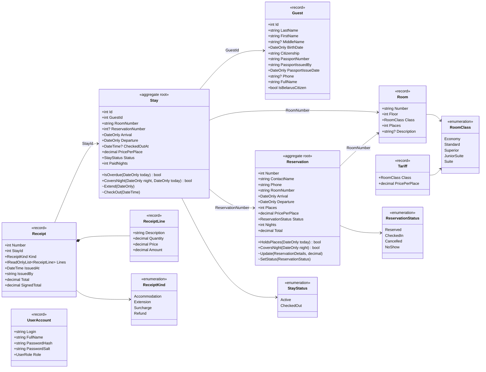
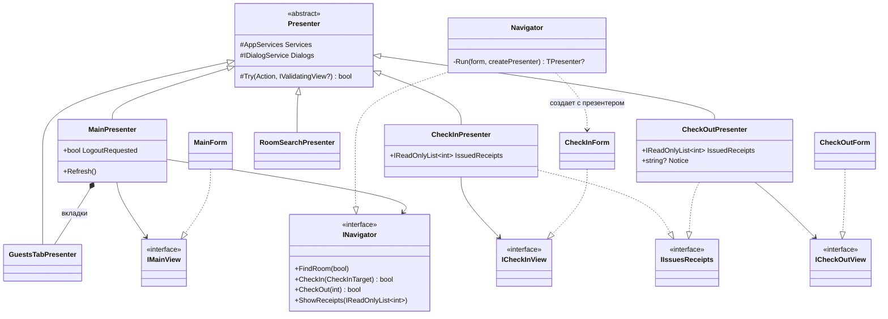

# Диаграмма классов

Диаграмма в формате Mermaid отображается на GitHub и в VS Code (расширение Markdown Preview Mermaid).

Обозначения: `+` — public, `~` — internal (меняет состояние, доступно только сервисам ядра), `-` — private.

## Предметная область (`Hotel.Core.Models`)

## Логика и хранение (`Hotel.Core`)

```mermaid
classDiagram
    direction TB

    class OccupancyCalculator {
        +OccupiedPlaces(string room, DateOnly night, OccupancyExclusion?) int
        +FreePlaces(Room, DateOnly from, DateOnly to, OccupancyExclusion?) int
        +MaxFutureOccupancy(string room) int
        +Today(Room) RoomOccupancy
    }

    class StayCalculator {
        <<static>>
        +TimeOnly CheckOutHour = 12:00
        +TimeOnly LateHalfDayUntil = 18:00
        +Nights(DateOnly, DateOnly) int
        +LateFraction(TimeOnly) decimal
        +Settle(Stay, DateTime) Settlement
    }

    class Settlement {
        <<record>>
        +int PaidNights
        +int ChargedNights
        +decimal LateFraction
        +decimal Paid
        +decimal Charged
        +decimal Difference
        +bool IsEarly
        +ReceiptKind? ReceiptKind
        +ReceiptLines() IReadOnlyList~ReceiptLine~
    }

    class IRoomService {
        <<interface>>
        +GetOccupancyToday(RoomClass?) IReadOnlyList~RoomOccupancy~
        +FindAvailable(RoomQuery) IReadOnlyList~RoomAvailability~
        +Add(Room)
        +Update(Room)
        +Delete(string)
    }

    class IReservationService {
        <<interface>>
        +Find(ReservationFilter) IReadOnlyList~Reservation~
        +GetArrivalsToday() IReadOnlyList~Reservation~
        +Create(ReservationDetails) Reservation
        +Update(int, ReservationDetails)
        +Cancel(int)
        +ExpireNoShows() int
    }

    class IStayService {
        <<interface>>
        +GetDeparturesToday() IReadOnlyList~GuestRow~
        +CheckIn(CheckInRequest) CheckInResult
        +Extend(int stayId, DateOnly) Receipt
        +PreviewCheckOut(int stayId) Settlement
        +CheckOut(int stayId) CheckOutResult
    }

    class IGuestService {
        <<interface>>
        +FindByPassport(string) Guest?
        +GetRows(GuestListFilter) IReadOnlyList~GuestRow~
        +Register(Guest) Guest
        +Update(Guest)
        +Delete(int)
    }

    class GuestSearch {
        <<static>>
        +Search(rows, GuestField, string?) IReadOnlyList~GuestRow~
    }

    class ITariffService {
        <<interface>>
        +GetPrice(RoomClass) decimal
        +Update(RoomClass, decimal)
    }

    class IReceiptService {
        <<interface>>
        +GetCard(int) ReceiptCard
        +GetForGuest(int) IReadOnlyList~Receipt~
        +Find(DateOnly, DateOnly) IReadOnlyList~Receipt~
        +Summarize(receipts) ReceiptSummary
    }

    class IAuthService {
        <<interface>>
        +UserAccount? CurrentUser
        +bool IsManager
        +Login(string, string) UserAccount
        +AddUser(...) UserAccount
        +ChangePassword(string, string)
    }

    class HotelContext {
        +List~Room~ Rooms
        +List~Tariff~ Tariffs
        +List~Guest~ Guests
        +List~Reservation~ Reservations
        +List~Stay~ Stays
        +List~Receipt~ Receipts
        +List~UserAccount~ Users
        +event Changed
        +Load()
        +SaveChanges()
        +ResetStorage(string)
    }

    class IRepository~T~ {
        <<interface>>
        +Load() List~T~
        +Save(IEnumerable~T~)
    }

    class JsonRepository~T~
    class IClock {
        <<interface>>
        +DateTime Now
        +DateOnly Today
    }

    StayCalculator ..> Settlement : создает
    IStayService ..> StayCalculator : Settle
    IStayService ..> OccupancyCalculator
    IReservationService ..> OccupancyCalculator
    IRoomService ..> OccupancyCalculator
    IRoomService ..> ITariffService
    OccupancyCalculator --> HotelContext
    OccupancyCalculator --> IClock
    HotelContext o-- IRepository~T~
    JsonRepository~T~ ..|> IRepository~T~
```

## Представление (`Hotel`) — Model-View-Presenter

Остальные формы устроены так же: интерфейс представления в `Views/IViews.cs`, презентер в `Presenters`, форма в `Forms`, открытие — в `Navigator`.
