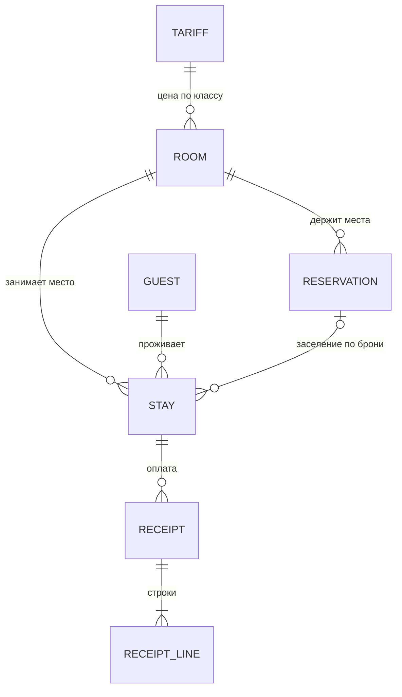
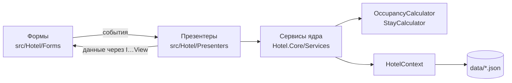

# Администратор гостиницы — план курсовой работы

> **Тема.** Администратор гостиницы. Список номеров: класс, число мест. Список гостей: паспортные данные, даты приезда и отъезда, номер. Поселение гостей: выбор подходящего номера (при наличии свободных мест), регистрация, оформление квитанции. Отъезд: выбор всех постояльцев, отъезжающих сегодня, освобождение места и оформление задержки с выпиской дополнительной квитанции. Возможность досрочного отъезда с перерасчетом. Поиск гостя по произвольному признаку.

| Паспорт проекта | |
|---|---|
| Дисциплина | Технологии программирования |
| Подход | объектно-ориентированный, итеративная разработка (vibe-coding), код на GitHub |
| Платформа | C# 13, .NET 9, Windows Forms |
| Архитектура | Model-View-Presenter (пассивное представление) |
| Хранение | JSON-файлы в папке `data/` |
| Валюта | белорусский рубль (BYN) |
| Репозиторий | `coursework-hotel-administrator` |
| Состояние на 30.10.2026 | все требования ФТ-01…ФТ-24 реализованы, 84 автотеста проходят |

Сокращения. **MVP** в плане спринтов — минимально жизнеспособный продукт (Minimum Viable Product). Архитектурный паттерн везде называется полностью — Model-View-Presenter, его классы — «презентеры». **ФТ** — функциональное требование, **ТК** — тест-кейс.

**Содержание**

1. [Задача](#1-задача)
2. [Пользователи и их работа](#2-пользователи-и-их-работа)
3. [Сущности предметной области](#3-сущности-предметной-области)
4. [Правила гостиницы](#4-правила-гостиницы)
5. [Функциональные требования](#5-функциональные-требования)
6. [Устройство программы](#6-устройство-программы)
7. [Ход работы по спринтам](#7-ход-работы-по-спринтам)
8. [Контрольные сценарии](#8-контрольные-сценарии)
9. [Журнал решений](#9-журнал-решений)

Связанные документы: [тест-кейсы](test-cases.md), [диаграмма классов](class-diagram.md), [скриншоты](screenshots/).

---

## 1. Задача

**Как сейчас.** В небольшой гостинице администратор ведет номера, брони и гостей в журнале или таблице. Чтобы поселить гостя или принять бронь, он вручную ищет номер нужного класса, где свободны места на весь срок с учетом проживающих и забронировавших, переписывает паспорт и считает сумму. Утром трудно собрать всех, кто сегодня заезжает и выезжает, а задержку выезда и досрочный отъезд пересчитывают на калькуляторе. Итог — одно место продано дважды, суммы с ошибками, споры с гостями.

**Что делает система.** Автоматизирует работу администратора: номерной фонд, бронирование, регистрацию, поселение и выезд с расчетом оплаты.

**Цель.** Сократить время поселения и выписки, исключить ошибки при подборе номера и расчете суммы.

**Что изменится:**

| Было | Стало |
|---|---|
| Свободное место ищется по журналу | Подходящий номер на нужные даты находится за секунды по классу и числу мест |
| Возможна двойная продажа места | Программа учитывает проживающих и брони — продать место дважды нельзя |
| Сумма считается вручную | Квитанции при поселении, продлении, задержке и досрочном отъезде формируются по тарифу |
| Списки заезда и отъезда собираются утром | «Заезд сегодня» и «Отъезд сегодня» (с незаездами и просроченными) всегда открыты |
| Гостя ищут по фамилии в журнале | Гость находится по любому признаку: фамилии, паспорту, номеру, датам |

## 2. Пользователи и их работа

Вход — по логину и паролю. Пароли хранятся как хеш с солью (PBKDF2), не открытым текстом.

- **Администратор** (ресепшн) — принимает брони, регистрирует и поселяет гостей, оформляет квитанции, продление, выписку и досрочный отъезд, ищет гостей.
- **Управляющий** — ведет номерной фонд и тарифы, учетные записи, смотрит журнал и все квитанции; может работать и как администратор.

### 2.1. Матрица функций

| Функция | Администратор | Управляющий |
|---|:---:|:---:|
| Список номеров с занятостью на сегодня (занято / забронировано / свободно мест) | ✔ | ✔ |
| Подбор номера по датам, классу и числу мест | ✔ | ✔ |
| Бронирование: контакт (ФИО, телефон), номер, даты, число мест | ✔ | ✔ |
| Изменение и отмена брони | ✔ | ✔ |
| Заезды на сегодня и незаезды | ✔ | ✔ |
| Регистрация гостя (ФИО, дата рождения, гражданство, паспорт, телефон), поиск повторного гостя по паспорту | ✔ | ✔ |
| Поселение по брони и без брони с квитанцией | ✔ | ✔ |
| Список гостей с фильтром «проживают / выехали / все», изменение данных гостя | ✔ | ✔ |
| Отъезжающие сегодня и не выехавшие в срок | ✔ | ✔ |
| Выписка с задержкой выезда и дополнительной квитанцией | ✔ | ✔ |
| Продление с дополнительной квитанцией | ✔ | ✔ |
| Досрочный отъезд с перерасчетом и квитанцией на возврат | ✔ | ✔ |
| Поиск гостя по произвольному признаку | ✔ | ✔ |
| Просмотр и печать квитанции | ✔ | ✔ |
| Номера: добавить, изменить, удалить (номер, этаж, класс, мест) | — | ✔ |
| Тарифы: цена за место в сутки по классам | — | ✔ |
| Учетные записи, смена пароля | — | ✔ |
| Все квитанции за период с итогом | — | ✔ |
| Журнал действий | — | ✔ |

### 2.2. Границы

| Входит в проект | Не входит |
|---|---|
| Настольное приложение Windows Forms | СУБД, сеть, одновременная работа нескольких пользователей |
| Хранение в JSON-файлах | Онлайн-бронирование гостем, предоплата, штрафы за отмену |
| Одна гостиница: номера, классы, тарифы | Прием оплаты (карты, касса, фискальные чеки) — квитанция фиксирует сумму, а не проводит платеж |
| Поселение и бронирование по местам: в многоместный номер селятся разные гости | Дополнительные услуги (питание, мини-бар), скидки, сезонные тарифы |
| Бронирование на будущие даты администратором | Уборка номеров, персонал, миграционный учет |
| Поселение, продление, выписка с задержкой, досрочный отъезд | |
| Квитанции и их печать | |
| Вход с двумя ролями, журнал действий | |

## 3. Сущности предметной области



Ниже — свойства в коде (`src/Hotel.Core/Models`) и ограничения, которые проверяют валидаторы и сервисы.

#### `Room` — номер
- `Number` — строка 1–5 символов: цифры и буква (`101`, `204а`), уникален;
- `Floor` — 1–30;
- `Class` — `RoomClass`: Эконом, Стандарт, Улучшенный, Полулюкс, Люкс;
- `Places` — 1–6;
- `Description` — необязательно.

#### `Tariff` — тариф
Ровно один на каждый класс; меняется, но не добавляется и не удаляется.
- `Class` — класс номера;
- `PricePerPlace` — цена за место в сутки, BYN, больше 0, две цифры после запятой.

#### `Guest` — гость
- `Id` — присваивается автоматически;
- `LastName`, `FirstName`, `MiddleName` — буквы, пробел, дефис, апостроф; отчество необязательно;
- `BirthDate` — не в будущем, не старше 120 лет;
- `Citizenship` — обязательно, по умолчанию «Республика Беларусь»;
- `PassportNumber` — уникален; для РБ 2 латинские буквы и 7 цифр (`MP1234567`), для других стран 5–20 букв и цифр;
- `PassportIssuedBy` — обязательно; `PassportIssueDate` — не в будущем и не раньше даты рождения;
- `Phone` — необязательно; `+` и 7–15 цифр.

#### `Reservation` — бронь (корень агрегата)
Держит места на будущие даты. Паспорт не нужен — гость регистрируется при заезде.
- `Number` — сквозная нумерация;
- `ContactName`, `Phone` — контактное лицо и телефон, обязательны;
- `RoomNumber` — существующий номер;
- `Arrival` — не раньше сегодня и не дальше 365 дней; `Departure` — позже приезда, срок до 90 суток;
- `Places` — от 1 до числа мест номера;
- `PricePerPlace` — копия тарифа на момент брони;
- `Status` — `ReservationStatus`: Забронировано → Заселено / Отменено / Незаезд;
- `Note`, `CreatedAt`, `CreatedBy` — примечание, когда и кем оформлена.

#### `Stay` — проживание (корень агрегата)
Один гость — одно место в номере на период; идентификатор служит номером регистрационной карточки.
- `Id`, `GuestId`, `RoomNumber`, `ReservationNumber` (если поселен по брони);
- `Arrival` — день поселения; `Departure` — плановый отъезд, меняется при продлении;
- `CheckedOutAt` — фактическое время выезда;
- `PricePerPlace` — из брони или тарифа на момент поселения;
- `Status` — `StayStatus`: Проживает → Выехал;
- `PaidNights` — оплаченные сутки (вычисляется).

#### `Receipt` и `ReceiptLine` — квитанция
Не изменяется и не удаляется: ошибка исправляется новой квитанцией.
- `Number`, `StayId`, `IssuedAt`, `IssuedBy`;
- `Kind` — `ReceiptKind`: Проживание, Продление, Доплата (задержка, неоплаченные сутки), Возврат (перерасчет);
- `Lines` — строки: `Description`, `Quantity`, `Price`, `Amount`;
- `Total` — сумма строк; у возврата — сумма к выдаче гостю.

#### `UserAccount` — учетная запись
- `Login` — уникален, латиница и цифры; `FullName` — печатается в квитанции;
- `PasswordHash`, `PasswordSalt` — PBKDF2, SHA-256, 100 000 итераций;
- `Role` — `UserRole`: Администратор, Управляющий.

## 4. Правила гостиницы

Это инварианты, которые программа соблюдает всегда; каждое правило покрыто автотестом.

### 4.1. Сутки и занятость

- **Р1.** Расчетный час — 12:00. Заезд — в день приезда, выезд — до 12:00 даты отъезда.
- **Р2.** Сутки считаются по датам: с 01.11 по 04.11 — 3 суток.
- **Р3.** В ночь `d` в номере заняты: активные проживания с `приезд ≤ d < отъезд` (по одному месту) и брони «Забронировано» с `приезд ≤ d < отъезд` (по числу мест брони).
- **Р4.** Свободно на период = мест в номере − максимум занятости по ночам периода. Бронь или поселение на `n` мест возможны, только если свободно не меньше `n` **на весь период**. Изменяемая бронь и продлеваемое проживание сами себя не учитывают.

### 4.2. Бронь

- **Р5.** Приезд — не раньше сегодня, срок 1–90 суток. Цена фиксируется в брони, оплата при бронировании не берется.
- **Р6.** Бронь, по которой не заселились до конца дня приезда, со следующего дня становится «Незаезд» и места не держит (проверка при входе и при обновлении списков).
- **Р7.** Отменить бронь можно в любой момент до заселения.

### 4.3. Поселение

- **Р8.** Без брони: приезд — сегодня, срок до 90 суток.
- **Р9.** По брони: только в день приезда, в ее номер и на ее даты; от 1 до «мест брони» гостей одной операцией. Бронь становится «Заселено», незанятые места освобождаются.
- **Р10.** У гостя не бывает двух активных проживаний сразу.
- **Р11.** Оплата вперед за все сутки: квитанция «Проживание» = `суток × цена за место`.
- **Р12.** Продление: новая дата отъезда позже текущей, добавленные ночи проверяются по Р4 (с будущими бронями); квитанция «Продление» на добавленные сутки.

### 4.4. Выезд — один расчет на все случаи

`StayCalculator.Settle` считает обычный, поздний и досрочный выезд одинаково:

1. начислено = `max(1, дата выезда − дата приезда) × цена` — сутки после плановой даты тоже начисляются;
2. задержка после 12:00: до 18:00 — 50 % цены суток, позже — полные сутки (в день приезда задержка не начисляется);
3. сравнение с оплаченным определяет квитанцию.

| Начислено против оплаченного | Квитанция | Пример (цена 60,00, оплачено 02.11–05.11 = 180,00) |
|---|---|---|
| Больше | «Доплата»: неоплаченные сутки, задержка | Выезд 05.11 в 15:00 → задержка 30,00 |
| Меньше | «Возврат» за неиспользованные сутки | Выезд 03.11 в 11:00 → начислено 60,00, возврат 120,00 |
| Равно | Не оформляется | Выезд 05.11 в 10:00 |

В любом случае место освобождается: проживание становится «Выехал», записывается время выезда.

### 4.5. Списки и удаление

- **Р13.** «Отъезд сегодня» — активные проживания с отъездом сегодня; просроченные (отъезд раньше сегодня) выделяются. «Заезд сегодня» — брони «Забронировано» с приездом сегодня.
- **Р14.** Номер нельзя удалить, если в нем жили или есть бронь; число мест нельзя уменьшить ниже занятости любой будущей ночи.
- **Р15.** Гостя с проживаниями удалить нельзя — на них ссылаются квитанции.
- **Р16.** Деньги — `decimal`, округление до копеек `MidpointRounding.AwayFromZero`.

## 5. Функциональные требования

Этап: **MVP** — спринты 3–4, **Доп.** — спринт 5. Все требования реализованы (✅) и проверены — см. [тест-кейсы](test-cases.md).

| ФТ | Система должна… | Этап | Готово |
|---|---|---|:---:|
| 01 | обеспечивать вход по логину и паролю и открывать функции по роли (администратор, управляющий) | Доп. | ✅ |
| 02 | обеспечивать добавление, изменение и удаление номера (номер, этаж, класс, число мест) | MVP | ✅ |
| 03 | обеспечивать изменение тарифа — цены за место в сутки для класса номера | Доп. | ✅ |
| 04 | отображать номера с классом, числом мест и занятыми, забронированными и свободными местами на сегодня с фильтром по классу | MVP | ✅ |
| 05 | обеспечивать регистрацию гостя с проверкой паспортных данных и изменение данных гостя | MVP | ✅ |
| 06 | отображать гостей с паспортными данными, датами приезда и отъезда и номером с фильтром «проживают / выехали / все» | MVP | ✅ |
| 07 | подбирать номер по датам, классу и числу мест — только со свободными местами на весь срок | MVP | ✅ |
| 08 | обеспечивать бронирование мест на будущие даты с контактным лицом и телефоном | MVP | ✅ |
| 09 | обеспечивать изменение и отмену брони | MVP | ✅ |
| 10 | отображать заезды на сегодня и переводить брони без заселения в «Незаезд» | MVP | ✅ |
| 11 | обеспечивать поселение по брони или без брони (новый гость или найденный по паспорту) | MVP | ✅ |
| 12 | запрещать бронирование и поселение без свободных мест, при неверных датах и если гость уже проживает | MVP | ✅ |
| 13 | оформлять при поселении квитанцию: номер, гость, паспорт, номер комнаты, класс, период, суток, цена, сумма | MVP | ✅ |
| 14 | отображать постояльцев, отъезжающих сегодня, и не выехавших в срок | MVP | ✅ |
| 15 | обеспечивать выписку гостя с освобождением места | MVP | ✅ |
| 16 | при выезде после расчетного часа оформлять задержку и дополнительную квитанцию | MVP | ✅ |
| 17 | обеспечивать продление с проверкой свободного места (с учетом броней) и дополнительной квитанцией | MVP | ✅ |
| 18 | обеспечивать досрочный отъезд с перерасчетом и квитанцией на возврат | MVP | ✅ |
| 19 | искать гостя по произвольному признаку: по выбранному полю или по всем полям | MVP | ✅ |
| 20 | отображать квитанции гостя и все квитанции за период с итогом | Доп. | ✅ |
| 21 | сохранять данные в JSON-файлы и загружать их при запуске | MVP | ✅ |
| 22 | при повреждении или отсутствии файла данных сообщать об этом и предлагать начать с пустым файлом, не завершаясь аварийно | Доп. | ✅ |
| 23 | вести журнал действий пользователя в файле лога | Доп. | ✅ |
| 24 | обеспечивать предварительный просмотр и печать квитанции | Доп. | ✅ |

## 6. Устройство программы

Методичка требует для Windows Forms логичную структуру форм, отсутствие бизнес-логики в обработчиках кнопок и классы предметной области. Отсюда три слоя:



- **Ядро** `Hotel.Core` — вся логика (подбор, бронь, расчет, проверки); о Windows Forms не знает.
- **Форма** реализует интерфейс представления (`ICheckInView` и т. п.): показывает данные и передает события.
- **Презентер** (`CheckInPresenter`) вызывает сервисы и управляет формой через интерфейс, поэтому тестируется с поддельным представлением, без окон.

### 6.1. Папки решения

```
coursework-hotel-administrator/
├─ src/Hotel/              приложение Windows Forms
│  ├─ Forms/               формы, построенные в коде; Ui.cs — Palette и DialogForm
│  ├─ Views/               интерфейсы представлений IMainView, ICheckInView, …
│  ├─ Presenters/          презентеры, строки таблиц, AppServices, INavigator
│  ├─ Services/            Navigator (форма + презентер), DialogService
│  ├─ Printing/            ReceiptPrinter: PrintDocument + предварительный просмотр
│  └─ Program.cs           корень композиции, загрузка данных, сеансы входа
├─ src/Hotel.Core/         библиотека предметной области
│  ├─ Models/              Room, Tariff, Guest, Reservation, Stay, Receipt, UserAccount
│  ├─ Occupancy/           OccupancyCalculator
│  ├─ Billing/             StayCalculator, Settlement
│  ├─ Services/            сервисы номеров, тарифов, гостей, броней, проживаний, квитанций, входа; IClock
│  ├─ Search/              GuestSearch, GuestField
│  ├─ Storage/             IRepository, JsonRepository, HotelContext
│  ├─ Validation/          RoomValidator, GuestValidator, ReservationValidator
│  ├─ Security/            PasswordHasher
│  └─ Logging/             IAuditLog, FileAuditLog
├─ tests/Hotel.Tests/      xUnit: ядро и презентеры
├─ tools/ui-smoke.ps1      проверка форм и скриншоты
└─ docs/                   план, диаграмма классов, тест-кейсы, скриншоты
```

### 6.2. Классы по слоям

**Модели.** `Room`/`RoomClass`, `Tariff`, `Guest`, `UserAccount`/`UserRole`, `Receipt`/`ReceiptLine`/`ReceiptKind` — неизменяемые записи. `Reservation` и `Stay` — корни агрегатов: методы изменения `internal`, их вызывают только `ReservationService` и `StayService`. `RoomAvailability` — результат подбора: номер, свободные места, стоимость.

**Расчеты.**
- `OccupancyCalculator` — занятость по ночам и свободные места на период, с исключением изменяемой брони или проживания (`OccupancyExclusion`).
- `StayCalculator` → `Settlement` — сутки, задержка, начислено, оплачено, доплата или возврат, строки квитанции.
- `GuestSearch` — поиск по `GuestField` или по всем полям.

**Сервисы** (интерфейс + реализация):

| Сервис | Отвечает за |
|---|---|
| `IRoomService` | номерной фонд, занятость на сегодня, подбор номера |
| `ITariffService` | тарифы по классам |
| `IGuestService` | регистрация, изменение, поиск по паспорту, список гостей |
| `IReservationService` | бронь, изменение, отмена, заезды сегодня, незаезды |
| `IStayService` | поселение, продление, выписка, досрочный отъезд, отъезды сегодня |
| `IReceiptService` | нумерация и выдача квитанций, выборка за период |
| `IAuthService` | вход, текущий пользователь, учетные записи (`PasswordHasher`) |

**Инфраструктура.** `IRepository<T>`/`JsonRepository<T>` — строгий JSON, запись через временный файл; `HotelContext` — единица работы с событием `Changed`; `IAuditLog`/`FileAuditLog` — журнал; `IClock`/`SystemClock` — «сейчас», подменяется в тестах.

**Интерфейс.** Презентеры `Login`, `Main`, `RoomSearch`, `ReservationEdit`, `CheckIn`, `GuestEdit`, `ExtendStay`, `CheckOut`, `Receipt`, `Rooms`, `RoomEdit`, `Tariffs`, `Receipts`, `Users`, `Log` (+ `Presenter`); формы `…Form` реализуют `I…View`; `Navigator` открывает форму с презентером и показывает квитанции после закрытия окна операции; `ReceiptPrinter` рисует бланк.

**Связи.** `Stay` ссылается на `Guest`, `Room` и, возможно, `Reservation`; `Reservation` — на `Room`; `Receipt` — на `Stay` и состоит из `ReceiptLine`; сервисы получают `HotelContext`, `OccupancyCalculator`, `IClock`, `IAuditLog` через конструктор. Подробно — [диаграмма классов](class-diagram.md).

### 6.3. Формы

| Окно | Кто | Что на нем |
|---|---|---|
| Вход | все | логин, пароль |
| Главная | все | панель «Сегодня»; вкладки «Гости», «Брони», «Заезд сегодня», «Отъезд сегодня», «Номера»; «Подобрать номер (F2)», «Поселить без брони (F3)»; меню «Управление» |
| Подбор номера | все | даты, класс, мест → номера со свободными местами и стоимостью; «Забронировать», «Поселить» |
| Бронь | все | контакт, телефон, номер, даты, мест, цена, сумма |
| Поселение | все | номер и даты, гости: поиск по паспорту или регистрация; «Оформить» |
| Гость | все | ФИО, дата рождения, гражданство, паспорт, телефон; ошибки у полей |
| Продление | все | новая дата отъезда, доплата |
| Выписка | все | оплачено, начислено, задержка, к доплате или к возврату |
| Квитанция | все | бланк, масштаб, печать |
| Номера, Номер, Тарифы, Квитанции за период, Пользователи, Журнал | управляющий | справочники, отчеты, учетные записи |

### 6.4. Паттерны

- **Model-View-Presenter, пассивное представление** (`Views`, `Presenters`, `Forms`) — в формах нет логики, презентеры тестируются без окон.
- **Внедрение зависимостей, корень композиции** (`Program`) — зависимости собираются в одном месте.
- **Репозиторий** (`IRepository<T>`) — хранение скрыто от логики, в тестах — память.
- **Единица работы** (`HotelContext`) — изменения сохраняются одним вызовом.
- **Корень агрегата** (`Reservation`, `Stay`) — меняются только через сервисы, проверяющие правила.
- **Навигатор — фабрика форм** (`INavigator`, `Navigator.Run`) — презентеры открывают окна, не зная конкретных форм.
- **Объект-значение** (`Room`, `Guest`, `ReceiptLine`, `Settlement`, `RoomAvailability`) — неизменяемость и сравнение по значению.

### 6.5. Инструменты

Windows Forms (`DataGridView`, `BindingSource`, `ErrorProvider`, `PrintDocument`, `PrintPreviewControl`) · `Microsoft.Extensions.DependencyInjection` · `System.Text.Json` · `Rfc2898DeriveBytes` · xUnit · анализаторы .NET `latest-recommended`, `.editorconfig`, `dotnet format`, предупреждения = ошибки.

## 7. Ход работы по спринтам

- [x] **Спринт 1. Тема.** Предметная область, выбор подхода (ООП) и стека (C#, Windows Forms, Model-View-Presenter).
  *Результат:* задание на курсовую, обоснование стека.
- [x] **Спринт 2. Требования.** Цель, роли, функции, границы, правила, ФТ-01…ФТ-24.
  *Результат:* разделы 1–5 этого плана.
- [x] **Спринт 3. Проектирование.** Схема классов, структура решения, репозиторий, `Hotel.Core`, проект тестов.
  *Результат:* [`class-diagram.md`](class-diagram.md), каркас решения.
- [x] **Спринт 4. MVP.** Модели, `JsonRepository`, `OccupancyCalculator`, `StayCalculator`, сервисы; главная форма; подбор, бронь, заезд по брони и без, квитанция; отъезд сегодня, выписка с задержкой, продление, досрочный отъезд; поиск гостя; сохранение.
  *Результат:* рабочий MVP — все ФТ с этапом «MVP».
- [x] **Спринт 5. Дополнительно.** Вход и роли (ФТ-01), тарифы (03), реестр квитанций (20), поврежденные файлы (22), журнал (23), печать (24), рефакторинг.
  *Результат:* все требования отмечены реализованными.
- [x] **Спринт 6. Тестирование.** 84 теста xUnit (расчеты, сервисы, хранилище, презентеры), ручные тест-кейсы, скрипт `tools/ui-smoke.ps1`.
  *Результат:* [`test-cases.md`](test-cases.md), 28 скриншотов.
- [ ] **Спринт 7. Оформление.** Пояснительная записка, README, финальная проверка, подготовка к защите.
  *Результат:* итоговый пакет.

Коммиты — не реже раза в неделю, всего не меньше 15, с префиксами `feat:`, `fix:`, `refactor:`, `test:`, `docs:`.

## 8. Контрольные сценарии

Опорные примеры для приемки. Условия: «сегодня» — понедельник 02.11.2026 10:00; «Стандарт» — 60,00 BYN за место в сутки; номер 201 — «Стандарт», 3 места. Полный список с автотестами и скриншотами — в [тест-кейсах](test-cases.md).

**Подбор и бронь (ФТ-07, 08, 09, 12)**
- Подбор на 10.11–12.11, «Стандарт», 2 места → только номера со свободными ≥ 2 мест в обе ночи, сумма 2 × 2 × 60,00 = **240,00**.
- Бронь 2 мест в 201 на те же даты → при повторном подборе в 201 свободно **1** место.
- Перенос брони на 11.11–13.11 проходит (бронь не мешает сама себе); после отмены места свободны.
- Бронь на вчера, поселение в полный номер, повторное поселение того же гостя → **отклонено** с понятным сообщением.

**Поселение (ФТ-05, 10, 11, 13)**
- Петров, паспорт `mp 1234567` → сохранен как `MP1234567`; поселение в 201 до 05.11 → квитанция «Проживание»: 3 суток × 60,00 = **180,00**.
- Бронь с приездом 01.11 без заселения → **«Незаезд»**, места не держит.

**Выезд (ФТ-14…18)**
- Гости с отъездом 02.11 и 01.11 (не выехал) → оба в «Отъезд сегодня», второй выделен как просроченный.
- Выписка в 10:00 → место свободно, квитанции нет; в 15:00 → «Доплата» **30,00**.
- Продление 05.11 → 07.11 → «Продление» **120,00**; продление на ночь, где все места забронированы, → отклонено.
- Досрочный выезд 03.11 в 11:00 → начислено 60,00, «Возврат» **120,00**.

**Остальное (ФТ-01, 19–24)**
- Неверный пароль — отказ; у администратора нет меню «Управление».
- Поиск: «Паспорт» = `MP12`, «Номер» = `201`, «Все поля» = `петров` → найдены нужные гости, регистр не важен.
- Испорченный `stays.json` → предложение начать с пустым файлом, без аварийного завершения.
- Перезапуск сохраняет гостей, брони и квитанции; квитанция открывается в предварительном просмотре.

## 9. Журнал решений

| Дата | Решение | Почему |
|---|---|---|
| 30.10.2026 | Поселение и бронь — **по местам**; цена — за место в сутки по классу номера | В теме — «при наличии свободных мест»; в многоместный номер селятся разные гости (подтверждено) |
| 30.10.2026 | **Бронирование есть**: только контакт без паспорта, без предоплаты и штрафов, незаезд — автоматически со следующего дня | Подтверждено; гости регистрируются при заезде |
| 30.10.2026 | Задержка выезда: до 18:00 — 50 % суток, позже — полные сутки | Подтверждено |
| 30.10.2026 | Валюта — BYN, деньги — `decimal` | Подтверждено |
| 30.10.2026 | Цена копируется в бронь и проживание | Смена тарифа не меняет обещанное и оплаченное и не влияет на перерасчет |
| 30.10.2026 | Выписка, задержка и досрочный отъезд — один `StayCalculator.Settle` | Три сценария не могут разойтись в расчете |
| 30.10.2026 | Занятость — одна функция `OccupancyCalculator` | Подбор, бронь, поселение, продление и изменение номера проверяют места одинаково |
| 30.10.2026 | Время — только через `IClock` | Расчетный час, «сегодня» и незаезды проверяются в тестах |
| 30.10.2026 | Квитанции не редактируются и не удаляются | Ошибка исправляется новой квитанцией, история сохраняется |
| 30.10.2026 | Формы строятся в коде, квитанции открывает навигатор после закрытия окна операции | Предсказуемая раскладка; квитанция не становится дочерним окном закрывающегося диалога |
| 30.10.2026 | Демонстрационные данные при первом запуске: `manager`, `admin`, 12 номеров на 3 этажах, тарифы, гости, брони, заезд и отъезд сегодня, просроченный выезд | Программу можно показать сразу; пароли — в README |
